# PlanMemo Project

PlanMemo is a personal task and productivity manager I built for my final project at the end of my first year of development school. It helps you keep track of your daily work, take notes, and stay focused using a timer. I built this entire project without using any frameworks or backend servers.

## What it does

The app has several tools to help with organization:

1. **Dashboard:** This is the main screen. It shows a greeting with your name, your tasks for the day, a small calendar, and a quick version of the focus timer.
2. **Tasks and Groups:** You can create lists of things to do. You can organize them into custom groups, add notes to them, and use "presets" (like Tomorrow or Next Week) to set due dates quickly.
3. **Notes:** A section to write down information. You can keep these notes separate or link them to specific tasks.
4. **Pomodoro Timer:** A focus tool that helps you work in intervals. It has settings for custom times, background sounds, and notification alerts.
5. **Calendar:** The app includes a calendar view. Right now, it renders the current month and shows dots on days that have tasks.
6. **Settings and Export:** You can change the app theme to dark or light mode and export a summary of your tasks into a format that is easy to print.

## How I built it

I used **Vanilla JavaScript** and stayed away from frameworks like React to better understand how web apps work.

### Tools used:

* **HTML5:** For the structure of the different views and pages.
* **CSS3:** For the styling, including the light and dark themes.
* **JavaScript:** To handle all the logic, like the timer and task management.
* **IndexedDB:** Since there is no backend, I used this to save all your data directly in your browser.
* **Signal System:** To manage the state of the app, I reused the custom signal system I created for my previous project, [DualClock](https://github.com/nebBouya/DualClock)

## Screenshots

### Dashboard

### Tasks and Groups

* **Quick Add:** 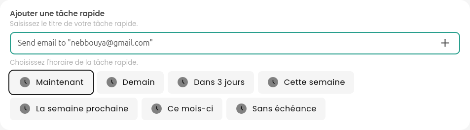
* **Tasks List:** 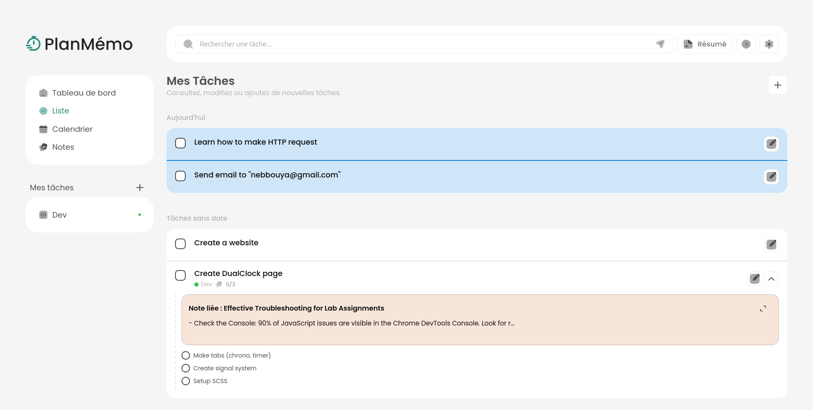
* **Adding Task:** 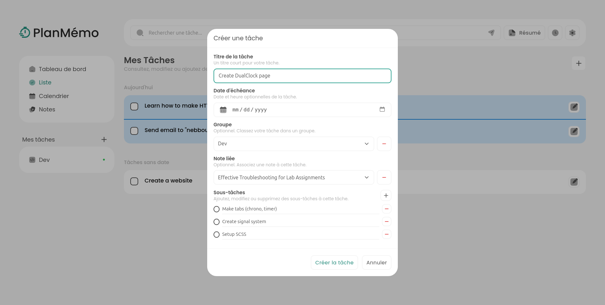
* **Creating Groups:** 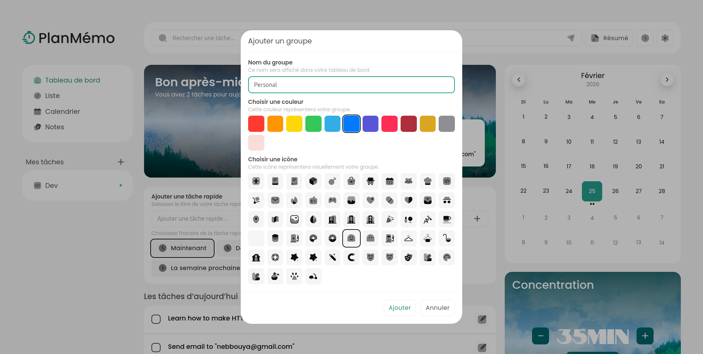
* **Group Element:** 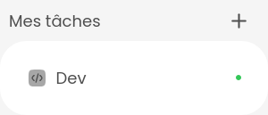

### Notes

* **Notes List:** 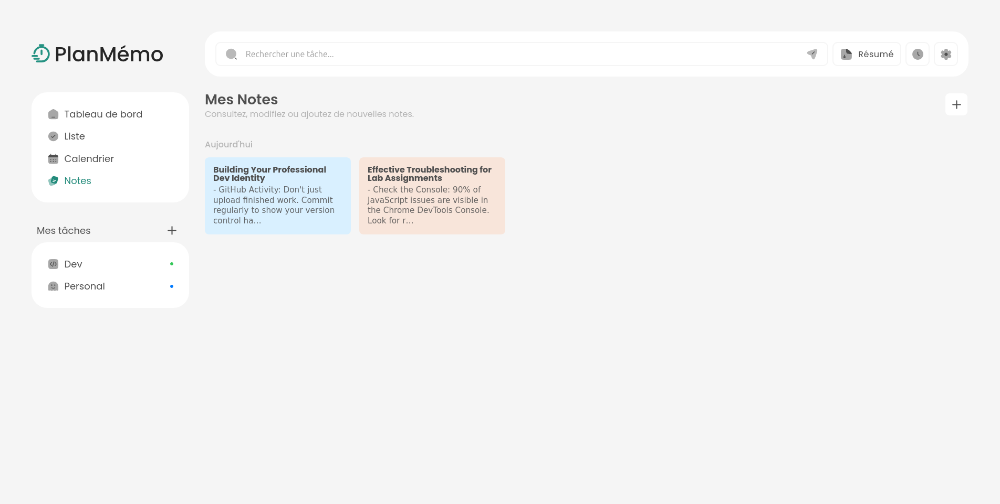
* **Adding Note:** 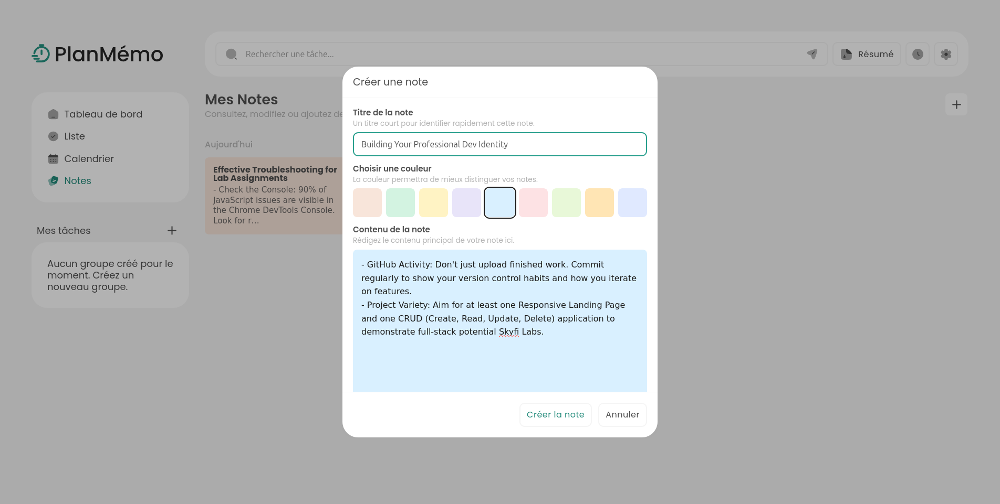
* **View Note:** 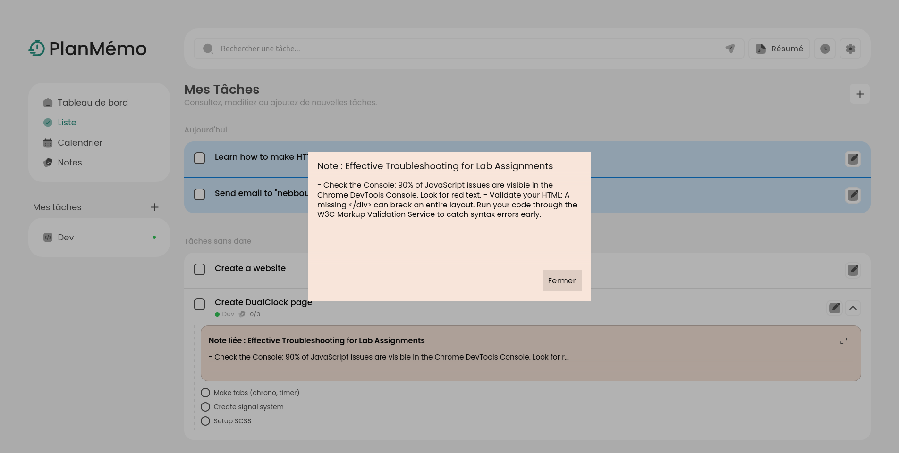

### Calendar

* **Full View:** 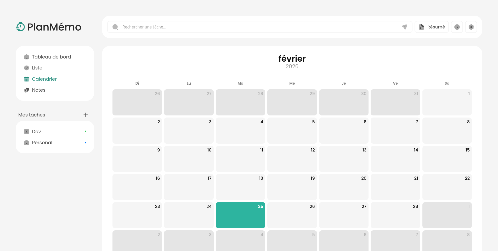
* **Mini View:** 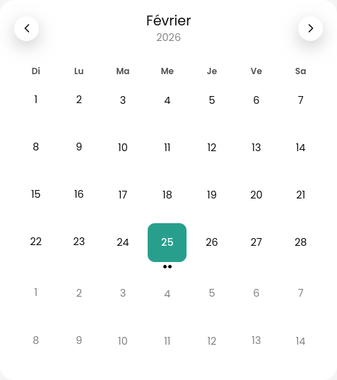

### Pomodoro Timer

* **Active:** 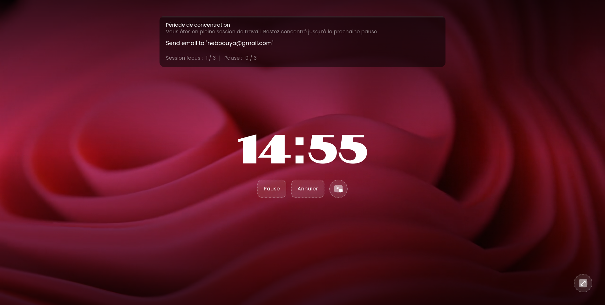
* **Idle:** 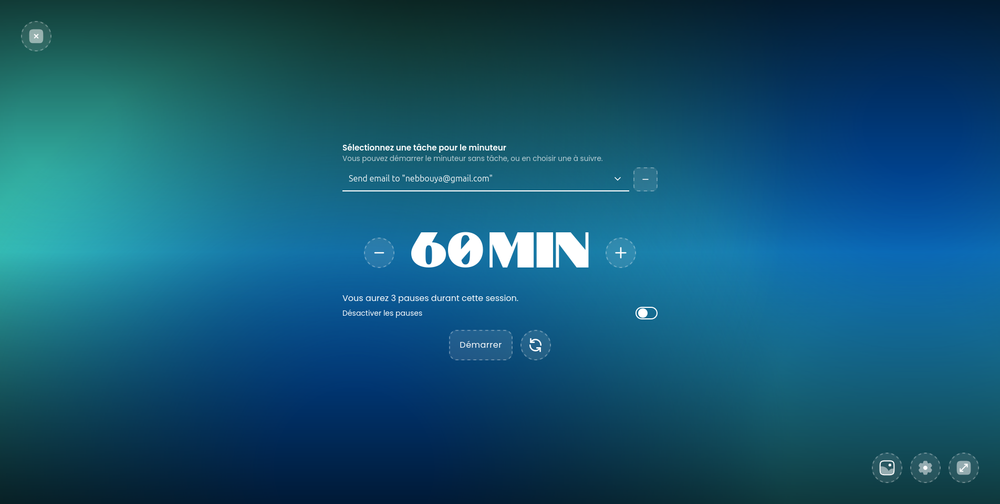
* **Dashboard Version:** 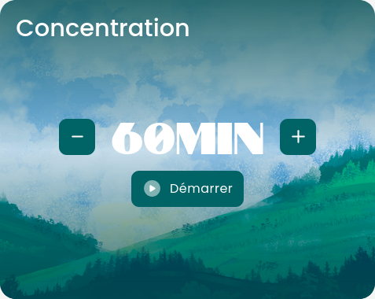
* **Settings:** 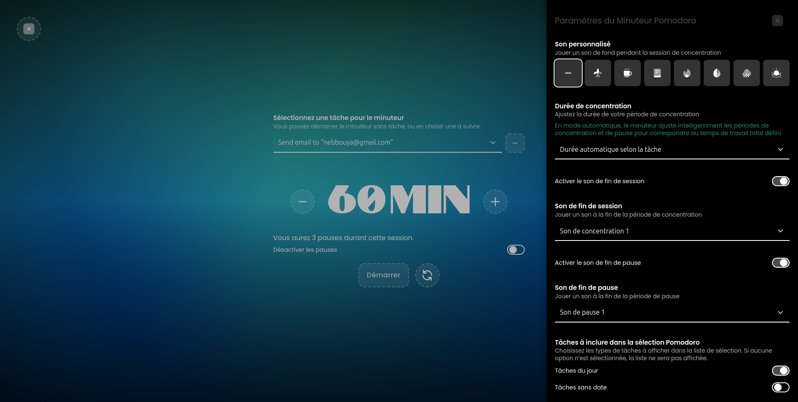
* **Themes:** 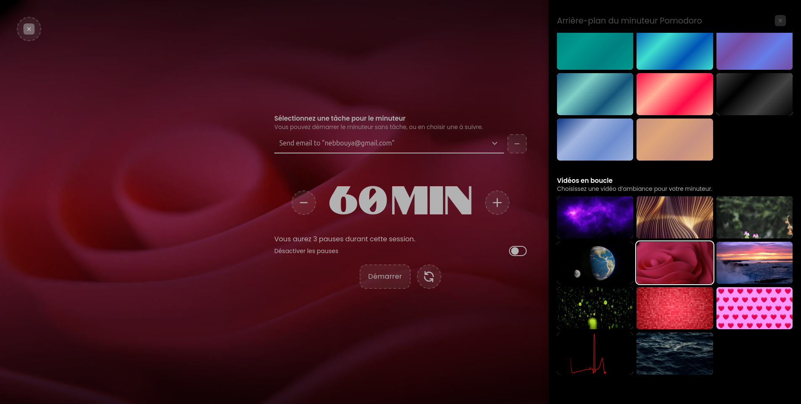

### Additional Features

* **Print Summary:** 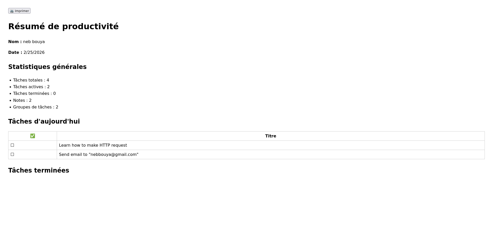
* **App Settings:** 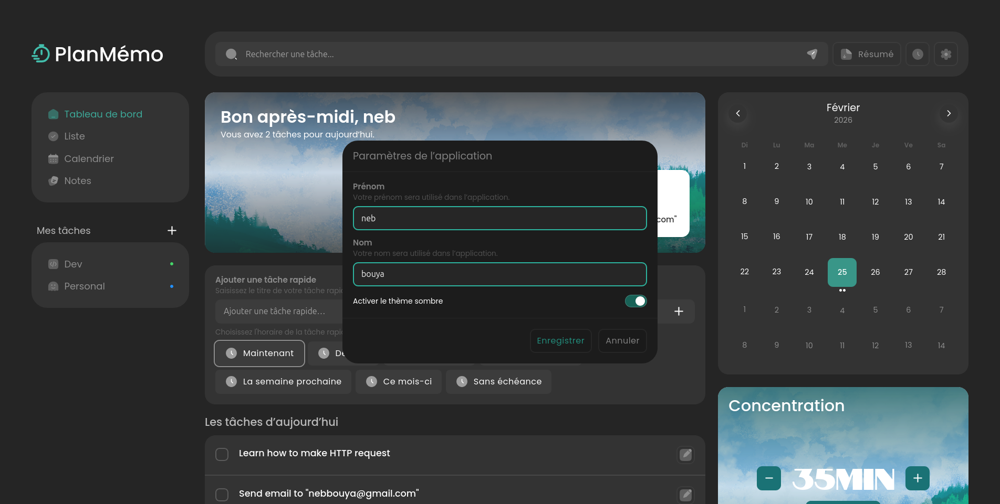

## What I learned

This project was a big step for me because:

* I learned how to use IndexedDB to store a lot of data locally without a database server.
* I practiced using the `h()` function and the DOM API to create elements dynamically.
* I learned how to move a custom logic system (the signals) from one project to another.
* **Note on Project Status:** I had to mark the project as finished when the school presentation date arrived. Because of this, the full calendar view only renders the current month. It does not yet support dragging tasks or creating tasks directly on the dates, which were features I originally planned to add.